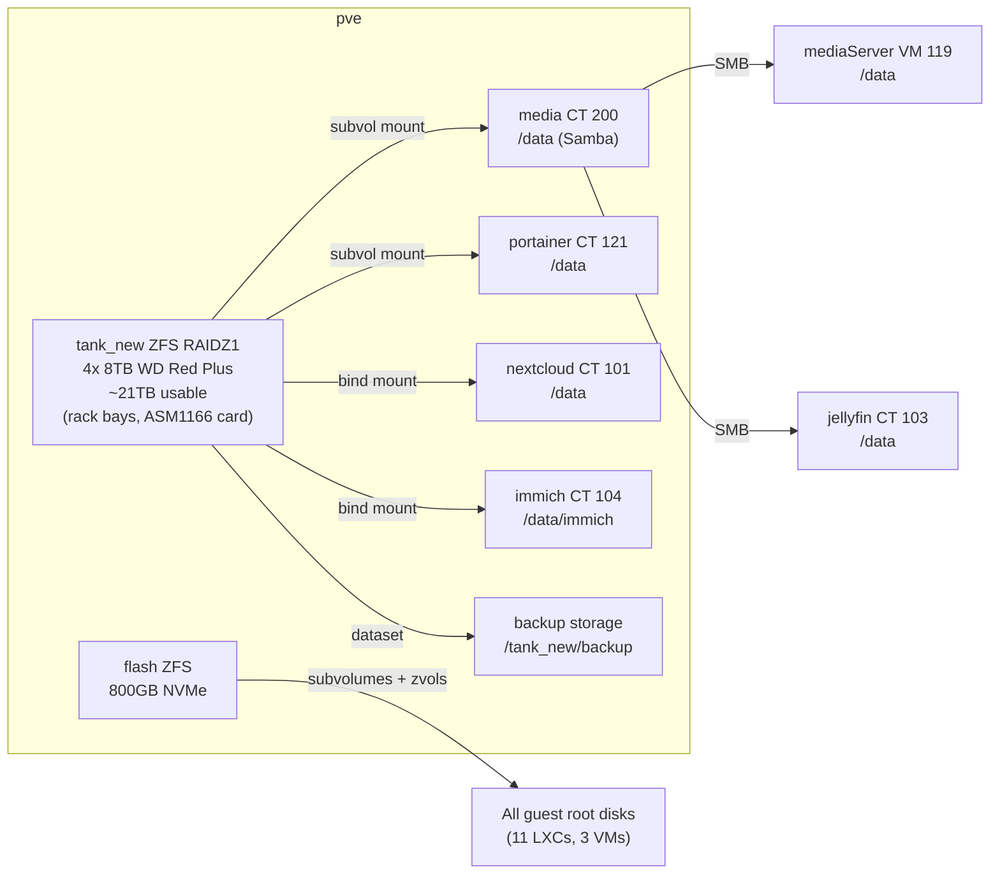

# Storage

## Overview

Since October 2026 all storage sits in one box. The 4-drive RAIDZ1 array moved out of the old storage node and into the 10-inch rack next to `pve`, connected over an M.2→SATA card. The NFS layer that used to join the two nodes is gone.

## Pools

### `tank_new`: bulk storage

4x 8TB WD Red Plus drives in RAIDZ1. It survives one drive failure, has about 21TB usable, and is roughly a third full. The drives sit in two printed 1U hot-swap bays in the rack, connected to the laptop through an **ASM1166 6-port M.2→SATA card**. A separate ATX power supply powers them. ZFS identifies each disk by its on-disk label, so bay order doesn't matter. Each caddy is labelled with its drive's serial so a failed disk can be found quickly.

The main dataset `tank_new:subvol-200-disk-0` (22TB quota) is mounted at `/data` in CT 200 (which re-exports it over Samba) and CT 121 (for Crafty's game data). CT 101 and CT 104 get sub-paths as Proxmox bind mounts.

**Data layout inside `/data`:**

| Path | Contents |
|------|----------|
| `/data/Movies` | Movie library |
| `/data/Shows` | TV library |
| `/data/music` | Music library |
| `/data/books` | Book library |
| `/data/downloads` | qBittorrent + NZBGet staging |
| `/data/immich` | Immich photo library + Postgres data |
| `/data/Nextcloud` | Nextcloud user data |
| `/data/servers` | Game server data (Crafty) |

A second dataset, `tank_new/backup`, holds the nightly vzdump archives. See [Backups](backups.md).

### `flash`: guest storage

An 800GB NVMe pool holds every container rootfs (ZFS subvolumes) and VM disk (zvols): adguard, nextcloud, claude, jellyfin, immich, guacamole, vaultwarden, jarvis, a private CT, portainer (24GB) and media (8GB), plus the mediaServer, amp and windows11 VM disks.

## How guests reach the array

| Method | Guest | Path |
|--------|-------|------|
| Subvolume mount (`mp0`) | CT 200 (media), CT 121 (portainer) | `/data` |
| Bind mount (`mp0`) | CT 101 (nextcloud) | `/tank_new/subvol-200-disk-0` → `/data` |
| Bind mount (`mp0` + `mp1`) | CT 104 (immich) | `…/immich` → `/data/immich` and `/mnt/photos` |
| SMB from CT 200 | CT 103 (jellyfin), VM 119 (mediaServer) | `//10.0.0.20/data` → `/data` |

VMs can't bind-mount host folders the way containers can, so the two VMs that need media use SMB. The third VM (AMP) used to mount its game data over NFS. That data moved onto the VM's own disk instead, which also put it in the nightly backup.

!!! tip "Mount resilience"
    A retry timer re-establishes Jellyfin's SMB mount if CT 200 comes up late after a power event. Immich can look like an **empty library** if its mount is missing, so check `mountpoint /data/immich` first before debugging the app.

!!! info "History: the NFS era"
    Until October 2026 the array lived in the old storage node (`pve-guide`) and was shared to `pve` over NFS: one export for Nextcloud, one for Immich, one for game data, and one as the backup target. Every one of those was a cross-node dependency. A late-booting storage node caused an empty Immich library more than once. Moving the drives replaced all of them with local mounts.

## Backups

Every guest is backed up nightly. See [Backups](backups.md).
